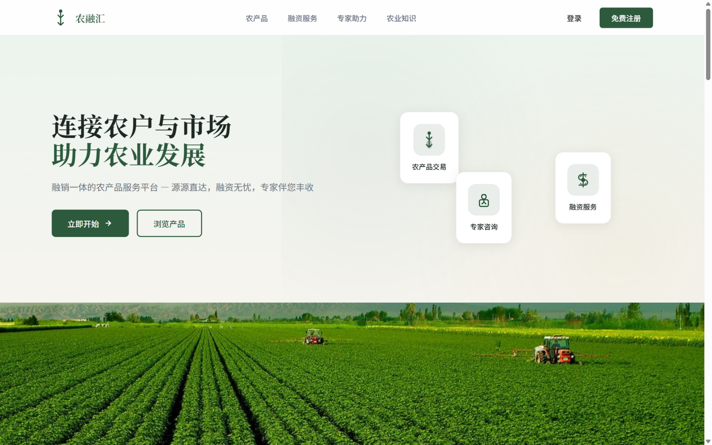

# 农产品融销一体平台（融销通）

融资 + 交易一体化平台：银行信贷产品对接农户融资，货源 / 需求双向撮合交易，集成**支付宝当面付**与 **RAG 智能问答助手**（bge-m3 检索增强）。

> 🌐 在线演示：[nongronghui.echeng.xyz](https://nongronghui.echeng.xyz)
> 技术栈：Spring Boot 3.2 · MyBatis-Plus · MySQL · Redis · JWT · 支付宝 SDK · Vue 3 · bge-m3 RAG



## 亮点速览（技术点 → 代码位置）

| 技术点 | 一句话说明 | 核心代码 |
|---|---|---|
| 融资业务闭环 | 审批事务内自动生成等额本息还款计划（BigDecimal 精算、末期校正） | `service/RepaymentService.java` |
| 支付宝当面付 | 二维码 + 回调幂等 + 数据库状态校验 | `service/AlipayService.java` · `controller/PayController.java` |
| RAG 问答 | 文档切块 → bge-m3 嵌入 → 向量检索 → 生成作答 | `service/AiRagService.java` |
| 文档切块 / 嵌入 | 语义切块；bge-m3 向量嵌入 | `service/DocumentChunkerService.java` · `service/BgeM3EmbeddingService.java` |
| 向量检索 | 余弦相似度检索 | `service/VectorSearchService.java` |
| AI 效果评估 | Node 评估器 + 25 条测试数据集，量化意图 / 动作准确率 | `tests/ai-evaluator.js` |

## AI 问答效果（真实 API 评估）

使用 `tests/ai-evaluator-real.mjs`（逐字复刻前端 SYSTEM_PROMPT，直调生产同源腾讯云 MaaS 接口，模型 hy4-preview）对 25 条测试集逐题实测，**24 条取得有效应答**（1 条因网络超时）：

| 指标 | 结果 |
|---|---|
| 关键词召回率（均值） | **82.4%**（8 题 100%、14 题 60–99%、2 题 <60%） |
| 快捷操作准确率 | **100%**（期望的【操作】全部正确触发） |
| 意图命中（严格口径） | **100%**（应答有效且命中期望关键词） |

> 复现：`node tests/ai-evaluator-real.mjs hy4-preview`。报告：`tests/ai-evaluation-report-real-final.json`。
> 对照：旧版 `ai-evaluator.js` 为模拟应答版（召回 49% / 动作 88%），真实模型显著更优。

## 核心特性

### 1. 融资业务闭环
```
银行发布产品 → 农户申请 → 审批事务内自动生成等额本息还款计划
            (BigDecimal 精算、末期校正) → 还款两阶段(凭证+银行确认) → 信誉分闭环
```

### 2. 交易与支付
- 货源 / 需求双向发布 → 下单 → **支付宝当面付**（二维码 + 回调幂等 + 数据库状态校验）
- 银行**四维评分**（信用 / 联合贷 / 活跃度 / 负担）+ 7:3 融合排序，银行间数据相互隔离
- 五角色权限体系 + 注册审核

### 3. RAG 智能问答
- 农业政策 / 金融知识知识库：**DocumentChunkerService** 切块 → **BgeM3EmbeddingService** 嵌入 → **VectorSearchService** 检索 → 大模型生成作答
- 腾讯云 MaaS API 接入大模型，意图识别 → 动作路由

## 架构

```
┌──────────────┐    ┌───────────────────────────────────┐
│  Vue 3 前端   │───▶│  Spring Boot 3.2                  │
│ (五角色权限)  │    │  ├─ JWT + Redis 会话               │
└──────────────┘    │  ├─ 融资: 审批/还款计划/信誉分       │
                    │  ├─ 交易: 撮合/支付宝当面付(幂等回调) │
┌──────────────┐    │  └─ RAG: 切块→bge-m3→检索→生成      │
│  支付宝平台    │◀───│                                   │
│ (扫码/回调)   │    │                                   │
└──────────────┘    └───────┬──────────────┬────────────┘
                      ┌─────▼────┐   ┌─────▼─────┐
                      │  MySQL   │   │   Redis   │
                      └──────────┘   └───────────┘
```

## 快速开始

```bash
# 1. 后端（密钥走 application-local.yml，已 gitignore；支付宝/腾讯MaaS 按需配置）
cd backend/agri-product-platform-backend
# 创建 application-local.yml：MySQL 密码、JWT secret、支付宝密钥等
./mvnw spring-boot:run

# 2. 前端
cd frontend/agri-product-platform-frontend
cp .env.example .env        # 填入 API 地址等
npm install
npm run dev

# 3. （可选）复跑 AI 效果评估
node tests/ai-evaluator.js
```

## 目录结构

```
├── backend/agri-product-platform-backend/   # Spring Boot 3.2 后端
│   └── src/main/java/com/agri/platform/
│       ├── controller/          # 融资/交易/支付/AI 接口层
│       ├── service/             # RAG、还款计划精算、支付宝等核心服务
│       └── entity/ mapper/      # MyBatis-Plus 数据层
├── frontend/agri-product-platform-frontend/  # Vue 3 + Vite + Element Plus
│   └── src/components/AIAssistant/          # AI 对话组件
├── tests/                       # AI 评估器 + 测试数据集 + 评估报告
└── docs/                        # 设计文档 / 截图
```

## 联系方式

- GitHub: [dkkfdjf](https://github.com/dkkfdjf)
- 邮箱: 19574486919@163.com
